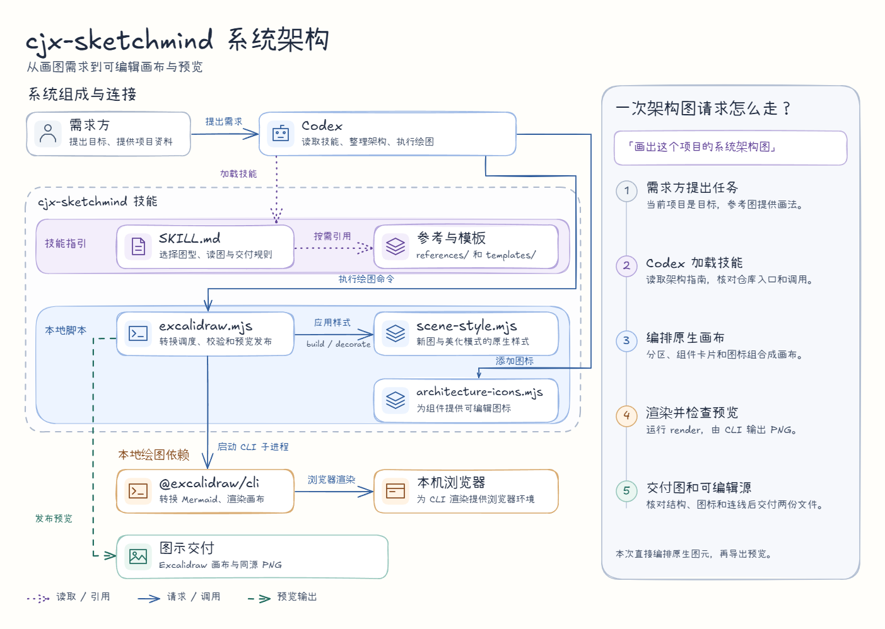

# cjx-sketchmind v1.5

彩色手绘技术与产品图解 Skill，可在 Codex 等支持本地技能和命令执行的编码助手中使用。默认通过免费的官方 Excalidraw CLI 生成原生画布和 PNG，SVG 按需导出，不需要 MCP、Plus 或 API Key。

优先按场景中的主体、动作和状态变化组织画面；必要时使用带技术标签的简笔主体或连续快照，也可组合专业图示。详见 [场景构图指南](references/scenario-composition.md)。

系统架构图默认先展示真实组件、层级、边界及连接，采用彩色手绘白板风格；示例系统和实际项目必须区分。详见 [架构构图指南](references/architecture-composition.md)。

支持业务流程图、系统流程图、功能清单图、低保真原型和静态甘特图。多角色业务流程默认使用连续平行泳道。产品图的选型、模板和检查见 [产品图指南](references/product-diagrams.md)。原型默认可编辑，甘特图的时间比例需在画布中核对。

## 系统架构



## 工作流程


先理解问题并整理知识，再选择合适的场景或图示；通过本地工具生成可编辑画布和预览，最后检查内容及排版。动画展示默认路径，具体步骤会根据任务调整。

静态版本：[查看完整流程图](docs/images/workflow.png)；[可编辑画布](docs/images/workflow.excalidraw)；[Mermaid 源文件](docs/images/workflow.mmd)。需要重新生成时，安装 Pillow 后运行 `python scripts/readme-workflow.py`。

## 本机使用

该目录已经安装在 `%USERPROFILE%\.codex\skills\cjx-sketchmind`。正常提问即可，例如：

> 用 cjx-sketchmind 画我的系统架构图，输出原生 Excalidraw 和预览，按当前代码说明模块边界。

环境要求：Node.js >=22、现有 Chrome / Chromium / Edge / Firefox。初始化与完整自检：

```powershell
./scripts/setup.ps1
```

自检包括中文、空格路径、原生图元转换与 SVG/PNG 渲染。默认用系统中文字体，不下载浏览器或额外字体。

环境已就绪时直接绘图，不在每次绘图前重复安装或完整自检。默认先给一张核心图和简短解释，分幕、动画与独立讲解文档按任务需要追加。

## 复制安装到其他环境

```powershell
./install.ps1
```

默认目标为 `%USERPROFILE%\.codex\skills\cjx-sketchmind`，并配置本地 CLI。已有目录按文件更新，不删除目录或创建整包备份；若当前已在目标位置，则只做环境配置。`-SkipSetup` 仅复制技能，不能视为环境已就绪。

只有明确要装到其他客户端时才指定其技能根目录，例如：

```powershell
./install.ps1 -InstallRoot "$env:USERPROFILE/.dsh/skills"
```

此更新不会自动写入 DSH。安装后需由对应客户端重新发现技能。

## 手动生成

以技能目录为当前位置：

```powershell
node ./scripts/excalidraw.mjs build ./templates/architecture.mmd --out "<交付目录>/01-overview"
node ./scripts/excalidraw.mjs render "<原图>.excalidraw" --out "<交付目录>/原图预览"
# 完整导出：保留原生画布，同时生成 SVG 和 PNG
node ./scripts/excalidraw.mjs build ./templates/architecture.mmd --out "<交付目录>/完整图" --preview both
# 已有原生图补 SVG：无需重新转换 Mermaid
node ./scripts/excalidraw.mjs render "<原图>.excalidraw" --out "<交付目录>/矢量预览" --preview svg
```

生成的 `.excalidraw` 可拖入 https://excalidraw.com/ 继续编辑。JSON 返回本轮输出清单及 `timingsMs` 分阶段耗时。详细参数、中文字体、原图修订与失败处理见 [本地执行说明](references/excalidraw-local.md)。图解与动画策略由 [SKILL.md](SKILL.md) 定义。

## 彩色教学图与设计配置

新图自动应用语义配色与原生样式。交互图需要阶段、内容卡片、编号、重点和修正分支时，可复用示例配置：

```powershell
node ./scripts/excalidraw.mjs build ./templates/agent-skill.mmd --design ./templates/agent-skill.design.json --out "<交付目录>/agent-skill"
# 明确要求美化已有图时，创建新副本；原始画布不变
node ./scripts/excalidraw.mjs decorate "<原图>.excalidraw" --design "<配置>.design.json" --out "<交付目录>/styled"
# 保留转换器的原始样式
node ./scripts/excalidraw.mjs build ./templates/architecture.mmd --plain --out "<交付目录>/plain"
```

12 项规则见 [视觉规范](references/visual-style.md)，配置字段和行为边界见 [本地执行说明](references/excalidraw-local.md)。样式处理在本地内存中完成，不额外启动浏览器；生成后的预览仍需查看检查。普通 `render` 始终保留现有图样式。

维护时运行 `node --test scripts/scene-style.test.mjs` 检查源场景不变、图元与绑定保留、显式配色保留及非法设计引用拒绝。
